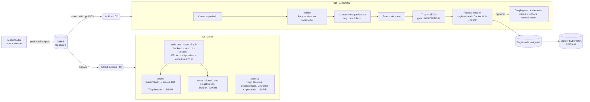

# Plataforma de seguimiento operativo · CI/CD

[](https://github.com/felipediazrosas/seguimiento-facilitadores-cicd/actions/workflows/ci.yml)

Repositorio de la **Actividad 3 · Laboratorio técnico** del Diplomado en Fundamentos DevOps (Universidad de La Sabana).
Contiene el código fuente de la aplicación web **«Guía de estandarización y seguimiento de facilitadores»** y los dos
pipelines que exige la guía de actividades:

| Pipeline | Herramienta | Archivo | Propósito |
|---|---|---|---|
| **CI** (integración continua) | GitHub Actions | [`.github/workflows/ci.yml`](.github/workflows/ci.yml) | Compilar, analizar, probar y validar cada push o pull request |
| **CD** (entrega continua) | Jenkins | [`Jenkinsfile`](Jenkinsfile) | Clonar, validar, construir la imagen Docker, escanearla y publicarla en un registro; despliegue opcional en Kubernetes |

> La documentación técnica completa de la entrega (informe, arquitectura, pipeline, matriz de cumplimiento y evidencias)
> está en [`entrega-actividad-3/`](entrega-actividad-3/README.md).

## La aplicación

Aplicación web de seguimiento operativo del Área de Implementación de Unisabana e-Learning: Coordinación ve la carga
del equipo, envía indicaciones y administra usuarios; cada facilitador gestiona su checklist diario, sus cursos,
sus novedades y sus tareas de cierre. Importa y exporta el Excel de programación dentro del navegador.

| Capa | Tecnología |
|---|---|
| Interfaz | HTML, CSS y JavaScript sin frameworks (`index.html`, `js/`, `css/`) |
| Servidor y API REST | Node.js (≥ 22) **sin dependencias de ejecución** (`server/server.js`) |
| Persistencia | Archivos JSON cifrados con AES-256-GCM (`DATA_DIR`); contrato REST para una base institucional (`db/`) |
| Seguridad | Usuarios con scrypt, sesión en cookie HttpOnly/SameSite=Strict, permisos por rol aplicados en el servidor |

Detalle funcional en [`plataforma-guia-implementacion/README.md`](plataforma-guia-implementacion/README.md).

## Flujo CI/CD



### CI — GitHub Actions (`ci.yml`)

Se ejecuta automáticamente en cada **push** (cualquier rama y tags `v*`) y en cada **pull request** hacia `main`.

| Job | Pasos | ¿Bloquea? |
|---|---|---|
| `build-test` (Node 22 y 24) | **Checkout** → **instalación de dependencias** (`npm ci`) → validación de sintaxis → **análisis estático** (ESLint) → **pruebas** con cobertura (umbral 70 %) → artefacto LCOV | Sí |
| `security` | Trivy fs (vulnerabilidades, secretos, configuración) → SARIF en *Security* → gates de secretos y de HIGH/CRITICAL → `npm audit` | Sí |
| `docker` | Build de la imagen → prueba de humo (health, no root, código del servidor protegido) → gate de Trivy sobre la imagen → SBOM CycloneDX | Sí |
| `sonar` | Análisis SonarCloud con Quality Gate bloqueante; se omite con un aviso si no existe el secreto `SONAR_TOKEN` | Sí, cuando está activo |

### CD — Jenkins (`Jenkinsfile`)

| Stage | Qué hace |
|---|---|
| Clonar repositorio | `checkout scm`; calcula la versión `<commit>-b<build>` (trazable) |
| Validar (lint + pruebas) | `docker build --target test` (npm ci + ESLint + pruebas dentro de un contenedor) |
| Construir imagen Docker | Imagen `runtime` sin npm, usuario no root, labels OCI con la revisión |
| Prueba de humo del contenedor | Arranca la imagen endurecida y verifica `/api/health` |
| Escaneo de seguridad (Trivy) | Reporte + SBOM archivados; bloquea si hay HIGH/CRITICAL corregibles |
| Publicar imagen en el registro | `docker push` al registro parametrizado (`REGISTRY`), con credencial opcional |
| Desplegar (Kubernetes) | Opcional (`DEPLOY_TARGET=kubernetes`): overlay kustomize con la imagen exacta, `rollout status`; rollback solo si el despliegue empezó |

Parámetros: `REGISTRY` (por defecto `localhost:5000`), `REGISTRY_CREDENTIALS_ID`, `PUSH_LATEST`, `DEPLOY_TARGET`.
El agente solo necesita Docker: Node.js, ESLint y Trivy se ejecutan en contenedores con versión fijada (entorno agnóstico).

## Ejecutar en local

```bash
cd plataforma-guia-implementacion
npm ci                 # dependencias de desarrollo (ESLint); el servidor no tiene dependencias
npm run lint           # análisis estático
npm test               # pruebas automatizadas
npm run test:coverage  # pruebas + cobertura (coverage/lcov.info)

# Con Docker Compose
cp .env.example .env   # completar DATA_KEY y ADMIN_PASS (no se versiona)
docker compose up --build -d   # http://localhost:8080
```

### Jenkins de laboratorio (CD local)

```bash
cd jenkins
cp .env.example .env   # JENKINS_ADMIN_PASSWORD y REPO_URL
docker compose up -d --build   # Jenkins en http://localhost:8081 + registro en localhost:5000
```

Jenkins queda configurado como código (JCasC): plugins, usuario administrador y el job `plataforma-guia-cd`, que lee el
`Jenkinsfile` de la rama `main`.

## Estructura del repositorio

```
.
├── .github/workflows/ci.yml       Pipeline CI (GitHub Actions)
├── .github/dependabot.yml         Actualización automática de dependencias y acciones
├── Jenkinsfile                    Pipeline CD (Jenkins)
├── jenkins/                       Jenkins de laboratorio como código (Dockerfile, plugins, JCasC, compose)
├── k8s/base/                      Manifiestos Kubernetes (kustomize) para el despliegue opcional
├── sonar-project.properties       Configuración de SonarCloud
├── plataforma-guia-implementacion/  Código fuente de la aplicación
│   ├── Dockerfile · compose.yaml · .env.example · .dockerignore
│   ├── package.json · eslint.config.js · test/
│   └── index.html · css/ · js/ · server/ · db/ · docs/ · vendor/
└── entrega-actividad-3/           Documentación técnica y evidencias de la Actividad 3
```

## Configuración opcional (propietario del repositorio)

| Elemento | Dónde | Para qué |
|---|---|---|
| Secreto `SONAR_TOKEN` + variables `SONAR_ORGANIZATION`, `SONAR_PROJECT_KEY` | Settings → Secrets and variables → Actions | Activar el job `sonar` |
| Protección de `main` con checks requeridos | Settings → Rules | Exigir CI verde antes de fusionar |
| Credencial `registry-creds` en Jenkins | Manage Jenkins → Credentials | Publicar en Docker Hub o GHCR en lugar del registro local |

## Créditos

Aplicación: Sebastián Castellanos Escárraga y André Leonard Duque Aricapa (Práctica en Estrategias de Mejora, Unisabana e-Learning).
Arquitectura DevOps (Actividad 2) e implementación CI/CD (Actividad 3): Luis Felipe Diaz Rosas.
