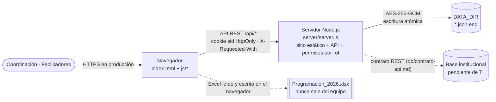
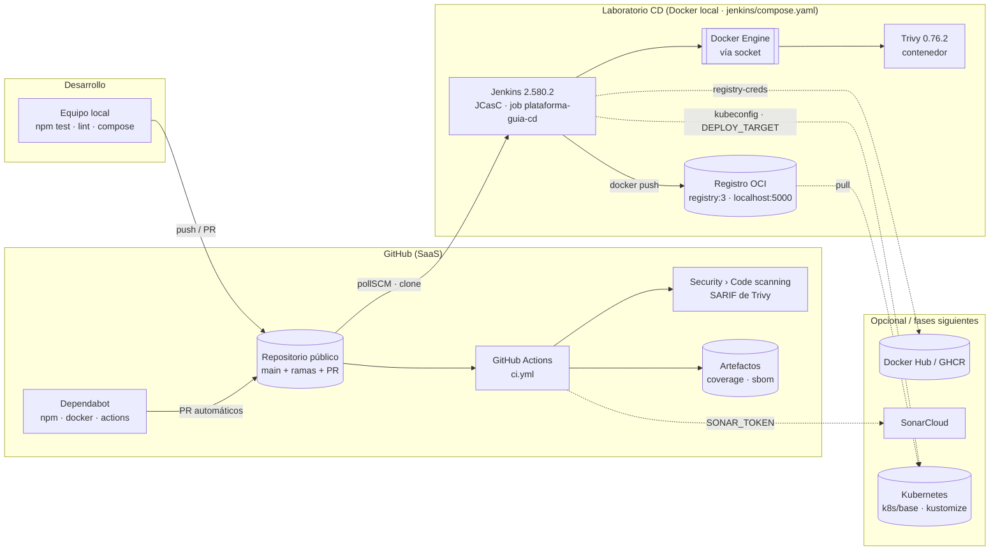

# Arquitectura implementada

Este documento materializa la arquitectura de la Actividad 2 (Figura 1 de aquel informe) y explica qué se implementó, qué cambió y por qué.

## 1. Arquitectura de la aplicación (sin cambios funcionales)

| Capa | Implementación | Relación con la Actividad 2 |
|---|---|---|
| Presentación | SPA sin frameworks; la interfaz cambia según el rol | Igual a lo definido |
| Servidor | Node.js sin dependencias: API REST, sesiones, autorización en el servidor | Igual a lo definido |
| Persistencia | Archivos cifrados (almacenamiento temporal protegido) | Opción temporal prevista en la Actividad 2 mientras TI define la base |

## 2. Arquitectura DevOps implementada

### 2.1 Componentes y su función

| Componente | Tecnología / versión | Función | Estado |
|---|---|---|---|
| Repositorio | GitHub (público) | Fuente única de verdad, PR, disparador del CI | Operativo |
| CI | GitHub Actions | Validar cada push y PR | Operativo (ejecuciones verdes y una roja demostrativa) |
| CD | Jenkins LTS 2.580.2 (JDK 21) + JCasC | Construir, verificar y publicar la imagen; desplegar (opcional) | Operativo en el laboratorio local |
| Contenedor | Docker multi-stage, `node:24-alpine` (Alpine 3.24.4, Node 24.22.3) | Artefacto inmutable del servidor | Operativo |
| Registro | `registry:3` (API Docker Registry v2, compatible con Docker Hub) | Almacenar las imágenes versionadas | Operativo. Docker Hub: pendiente de credenciales |
| Seguridad | Trivy 0.76.2, npm audit, hadolint, Dependabot | SCA, secretos, IaC, imagen, SBOM | Operativo |
| Calidad | ESLint 10.15; SonarCloud | Análisis estático; Quality Gate | ESLint operativo; SonarCloud pendiente de credenciales |
| Orquestación | Kubernetes (kustomize) | Despliegue en la fase siguiente | Manifiestos validados (kubeconform, Trivy); despliegue no ejecutado |

## 3. Decisiones de arquitectura

| # | Decisión | Alternativas | Justificación |
|---|---|---|---|
| ADR-1 | CI en GitHub Actions y CD en Jenkins | Todo en Actions (Actividad 2) | Lo exige la guía. Además separa responsabilidades y credenciales: el CI no publica nada |
| ADR-2 | Una sola imagen (sitio + API) | Nginx + API (referencia) | El servidor ya sirve los estáticos con controles (bloquea `server/`, datos y ocultos). Una segunda imagen solo añadiría superficie |
| ADR-3 | Runtime sin npm y con raíz de solo lectura | Imagen base sin cambios | El CRITICAL que bloqueó a la referencia venía del npm de la base. Resultado: 0 HIGH/CRITICAL |
| ADR-4 | Registro local en el laboratorio, parametrizable | Docker Hub fijo | Publicación real y verificable sin crear cuentas ni secretos. Docker Hub o GHCR con un parámetro y una credencial |
| ADR-5 | Kubernetes con 1 réplica y estrategia `Recreate` | 2+ réplicas con RollingUpdate | Sesiones en memoria y datos en archivos: varias réplicas tendrían estados distintos y escrituras concurrentes. Escalar requiere la base institucional |
| ADR-6 | Pruebas con `node:test`, sin frameworks | Jest / Mocha | Igual que la referencia; cero dependencias en la imagen de prueba; cobertura nativa en LCOV |
| ADR-7 | Jenkins como código (Dockerfile + plugins + JCasC) | Configuración manual en la UI | Reproducible con `docker compose up`; el job y la seguridad quedan versionados |
| ADR-8 | Despliegue k8s detrás de un parámetro (`none` por defecto) | Desplegar en cada build | La guía pide definir el CD y anuncia k8s para la fase siguiente; no se despliega en ningún entorno sin autorización |

## 4. Seguridad por capas (continuidad con OWASP, Actividad 2)

| Capa | Control | Dónde |
|---|---|---|
| Código | Autorización en el servidor, scrypt, cookies protegidas, anti-CSRF (ya existían) — **ahora con pruebas** | `server.js`, `test/server.api.test.js` |
| Repositorio | Gate de secretos; `.gitignore` para Excel, datos, `.env` y claves | `ci.yml`, `.gitignore` |
| Dependencias | Trivy + npm audit + Dependabot | `ci.yml`, `dependabot.yml` |
| Pipeline | Permisos mínimos, acciones por SHA, credenciales por ID, `--password-stdin`, claves efímeras ocultas | `ci.yml`, `Jenkinsfile` |
| Imagen | Sin npm, no root, solo lectura, `cap_drop ALL`, `no-new-privileges`, HEALTHCHECK, escaneo y SBOM | `Dockerfile`, `compose.yaml` |
| Orquestación | PSA `restricted`, `securityContext` endurecido, sin token de ServiceAccount, NetworkPolicy, Secret fuera del repositorio | `k8s/base/` |
