# Pipelines de integración y entrega continua para una aplicación web de seguimiento operativo

**Luis Felipe Diaz Rosas**
Universidad de La Sabana · Diplomado en Fundamentos DevOps
Unidad: Flujos de entrega eficientes — CI/CD y automatización
Actividad 3: Laboratorio técnico (Evaluativa) · Docente: María Fernanda Ochoa Paipilla
24 de noviembre de 2026

**Repositorio:** https://github.com/felipediazrosas/seguimiento-facilitadores-cicd

---

## 1. Introducción

En la Actividad 2 se diseñó una arquitectura DevOps para una aplicación web de seguimiento operativo. La aplicación es la *Guía de estandarización y seguimiento de facilitadores* del Área de Implementación de Unisabana e-Learning: Coordinación supervisa la carga y las novedades del equipo, y cada facilitador gestiona sus cursos, sus listas de verificación y sus cierres.

Aquel diseño proponía empezar con «un repositorio Git y un flujo de integración continua que ejecute pruebas y análisis de dependencias». Este laboratorio lleva ese diseño a la práctica, según la guía de la Actividad 3: dos pipelines, uno de **integración continua con GitHub Actions** y otro de **entrega continua con Jenkins**, para la aplicación alojada en GitHub y preparada para desplegarse más adelante en Kubernetes.

Como base metodológica se usó la biblioteca de *skills* DevOps/DevSecOps, que reconstruye mediante ingeniería inversa el laboratorio de referencia de la docente (`lab-devsecops-killercoda`). De ella se tomaron las buenas prácticas y se corrigieron los defectos documentados (Anexo A4).

## 2. Objetivos

**General.** Automatizar la validación y la entrega de la plataforma mediante un pipeline CI en GitHub Actions y un pipeline CD en Jenkins, con evidencia de ejecución real.

**Específicos.**

1. Ejecutar automáticamente, en cada push y pull request, el checkout, la instalación de dependencias, la compilación, el análisis estático y las pruebas.
2. Definir en un Jenkinsfile los stages para clonar el repositorio, construir una imagen Docker y publicarla en un registro, de forma independiente del entorno.
3. Integrar controles de seguridad (secretos, dependencias, configuración e imagen), en continuidad con la Actividad 2.
4. Documentar el flujo, las decisiones y las evidencias, distinguiendo lo verificado de lo pendiente.

## 3. Descripción del proyecto

| Aspecto | Detalle |
|---|---|
| Aplicación | SPA en HTML/CSS/JavaScript sin frameworks + servidor Node.js sin dependencias de ejecución (sitio estático y API REST) |
| Funciones | Equipo (índice de carga y fases), panel del facilitador (checklist diario, programación, cursos, indicaciones), novedades, proceso estándar de 9 etapas, plantillas, usuarios; importación y exportación del Excel de programación en el navegador |
| Seguridad existente | scrypt con sal, cookie HttpOnly/SameSite=Strict, bloqueo por intentos, anti-CSRF, autorización por rol en el servidor, datos cifrados con AES-256-GCM |
| Estado inicial | Código en un ZIP, sin repositorio, sin pruebas, sin linter, sin contenedor y sin pipelines (Anexo A3) |

El diagnóstico (Anexo A3) también identificó tres riesgos: la librería SheetJS 0.18.5 tiene vulnerabilidades conocidas; la aplicación no escala horizontalmente (sesiones en memoria y datos en archivos); y la documentación declara 63 controles del estándar mientras el código define 62.

## 4. Arquitectura

La arquitectura de la aplicación no cambió (tres capas, permisos en el servidor). La arquitectura DevOps implementada es esta:

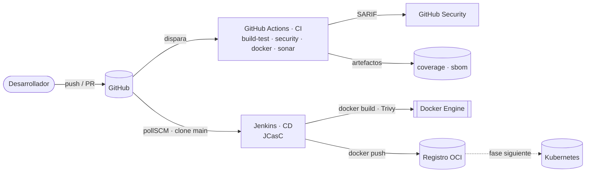

El detalle de componentes, las decisiones (ADR-1 a ADR-8) y la seguridad por capas están en [ARQUITECTURA_IMPLEMENTADA.md](ARQUITECTURA_IMPLEMENTADA.md). La continuidad con la Actividad 2, componente por componente, está en el [Anexo A2](ANEXOS/A2_CONTINUIDAD_ACTIVIDAD_2.md).
Hubo una diferencia relevante entre ambas actividades: la Actividad 2 proponía el CD en GitHub Actions y la guía de la Actividad 3 lo exige en Jenkins. Se siguió la guía.

## 5. Tecnologías utilizadas y justificación

| Herramienta | Versión | Para qué | Por qué se eligió |
|---|---|---|---|
| Git + GitHub | — | Control de versiones, PR, disparador | Lo exige la guía; definido en la Actividad 2 |
| GitHub Actions | ubuntu-latest | CI | Integrado al repositorio, sin infraestructura y gratuito en repositorios públicos; exigido por la guía |
| Jenkins LTS | 2.580.2 (JDK 21) | CD | Exigido por la guía. Pipeline declarativo versionado; configurado como código (JCasC) para que sea reproducible |
| Node.js | 22 y 24 (LTS) | Runtime y pruebas | Runtime de la aplicación; se prueban las dos LTS vigentes |
| `node:test` | nativo | Pruebas y cobertura LCOV | Sin dependencias, igual que la referencia; umbral de cobertura nativo |
| ESLint | 10.15.0 | Análisis estático | Estándar del ecosistema JavaScript |
| SonarCloud | — | Calidad y Quality Gate | Gratuito para repositorios públicos; preparado, pendiente del token |
| Docker / BuildKit | 29.x | Imagen OCI multi-stage | Artefacto inmutable y portable (Turnbull, 2014); exigido por la guía |
| Trivy | 0.76.2 | Secretos, SCA, IaC, imagen, SBOM | Una sola herramienta para cuatro superficies, como en la referencia |
| npm audit · Dependabot | — | SCA y actualización de dependencias | Integrados en npm y GitHub |
| hadolint · actionlint · kubeconform | 2.14.0 · 1.7.12 · 0.7.0 | Validación de Dockerfile, workflow y manifiestos | Detectan errores antes de ejecutar |
| Docker Registry | `registry:3` | Registro OCI del laboratorio | Compatible con la API de Docker Hub; demuestra la publicación sin cuentas externas |
| Kubernetes + kustomize | — | Despliegue (fase siguiente) | Destino que anuncia la guía; el overlay fija la imagen exacta |

## 6. Implementación DevOps

1. **Repositorio y flujo de trabajo.** Repositorio público con `main` como rama de integración (trunk-based). Los cambios entran por pull request: el PR #1 corrigió un hallazgo del propio pipeline. `.gitignore` en dos niveles (Excel, datos, `.env`, claves, reportes) y `.gitattributes` con finales de línea LF.
2. **Pruebas automatizadas** (`plataforma-guia-implementacion/test/`), 43 pruebas en 9 suites:
   - **API HTTP (22):** health; anti-CSRF; 401 sin sesión; login con cookie segura; bloqueo tras 5 intentos; gestión de usuarios (400/409); el facilitador solo recibe sus cursos y módulos; 403 al escribir el Excel o en cursos ajenos; campos permitidos en indicaciones; `/versions`; cifrado en disco; protección de `server/`, archivos ocultos y *path traversal*.
   - **Estándar (7):** 9 etapas, plantillas referenciadas, 16 plantillas, 11 controles diarios.
   - **Reglas de negocio (14):** las 6 fases de `fase()` con sus límites, los pesos del índice de carga y las utilidades de Excel.

   Las funciones del navegador se extraen del archivo real y se evalúan en un contexto aislado, sin modificar el código fuente.
3. **Testeabilidad.** Único cambio en el código de la aplicación: `server.js` exporta el servidor y solo llama a `listen()` cuando se ejecuta directamente. Se verificó que la ejecución directa es idéntica.
4. **Contenedor.** El `Dockerfile` multi-stage tiene dos etapas:
   - `test`: `npm ci` + lint + pruebas;
   - `runtime`: Node 24 Alpine sin npm, archivos de la aplicación de solo lectura propiedad de root, usuario `node`, volumen `/data`, HEALTHCHECK y labels OCI.

   `compose.yaml` exige `DATA_KEY` y `ADMIN_PASS` desde un `.env` no versionado y ejecuta el contenedor de solo lectura, sin capacidades y con `no-new-privileges`. La imagen pesa 63 MB.
5. **Infraestructura como código.**
   - `k8s/base/`: Namespace con PSA `restricted`; Deployment con 1 réplica y estrategia `Recreate`; PVC; Service; NetworkPolicy; Secret creado fuera del repositorio.
   - `jenkins/`: Dockerfile, plugins y JCasC, que levantan Jenkins con el job ya creado.

## 7. Implementación DevSecOps

| Control | Herramienta | Momento | Bloquea | Resultado |
|---|---|---|---|---|
| Secretos en el repositorio | Trivy secret | Cada push / PR | Sí | 0 |
| Vulnerabilidades en dependencias | Trivy vuln + npm audit | Cada push / PR | Sí (HIGH/CRITICAL) | 0 |
| Configuración (Dockerfile, k8s) | Trivy misconfig, hadolint | Cada push / PR | Sí (HIGH/CRITICAL) | 0 HIGH/CRITICAL; 2 LOW aceptados |
| Vulnerabilidades de la imagen | Trivy image | CI y Jenkins, antes de publicar | Sí | 0 HIGH/CRITICAL |
| Inventario de componentes | SBOM CycloneDX | CI y Jenkins | No | Artefactos generados |
| Visibilidad centralizada | SARIF → GitHub Code Scanning | Cada push / PR | No | 3 alertas LOW, analizadas |
| Cadena de suministro del pipeline | Acciones por SHA, permisos mínimos, versiones fijadas | Siempre | — | actionlint sin hallazgos |
| Credenciales | Jenkins Credentials, `--password-stdin`, `.env` ignorado, Secret de k8s | — | — | Ningún valor en el repositorio |

Las vulnerabilidades de SheetJS 0.18.5 no las detecta ningún escáner porque el archivo está minificado y no tiene metadatos de paquete. Se documentan como riesgo residual, con su mitigación y la recomendación de actualizar (Anexo A6 §2). Es un hallazgo que muestra los límites del escaneo automatizado.

## 8. Configuración del pipeline

La descripción completa, etapa por etapa, con disparadores, gates, parámetros y credenciales, está en [PIPELINE_DEVOPS.md](PIPELINE_DEVOPS.md). Resumen:

- **CI (`ci.yml`):** `push` (todas las ramas, tags `v*`), `pull_request` a `main` y manual. Tiene 4 jobs:
  - `build-test` (matriz Node 22/24): checkout → `npm ci` → sintaxis → ESLint → pruebas con cobertura ≥ 70 %;
  - `security`: Trivy, SARIF y `npm audit`;
  - `docker`: build, smoke test, gate de Trivy y SBOM;
  - `sonar`: condicional al token.
- **CD (`Jenkinsfile`):**
  1. **Clonar repositorio**
  2. Validar (lint + pruebas)
  3. **Construir imagen Docker**
  4. Prueba de humo del contenedor
  5. Escaneo de seguridad (Trivy)
  6. **Publicar imagen en el registro**
  7. Desplegar (Kubernetes, opcional)

  Bloque `post` con rollback condicionado. En negrita, los tres stages que exige la guía.

## 9. Pruebas realizadas

Se validaron 33 aspectos (Anexo A6), en tres niveles:

- **Estáticas:** sintaxis, ESLint, actionlint, hadolint, kubeconform, kustomize, Trivy config, compose.
- **Dinámicas:** pruebas automatizadas, cobertura, build, smoke del contenedor endurecido, Trivy fs e imagen, ejecución de la imagen publicada.
- **De plataforma:** ejecuciones reales en GitHub Actions y Jenkins.

Además se hicieron dos **pruebas negativas** para demostrar que los controles bloquean:

1. Una aserción alterada a propósito en una rama desechable dejó el CI en rojo, y la construcción de la imagen no llegó a ejecutarse.
2. Un build de Jenkins contra un registro inexistente falló en «Publicar» sin revertir nada, porque el despliegue no había empezado.

## 10. Resultados

| Indicador | Resultado |
|---|---|
| Ejecución del CI en push a `main` | Verde, 5/5 jobs, 48 s ([run 45504468140](https://github.com/felipediazrosas/seguimiento-facilitadores-cicd/actions/runs/45504468140)) |
| CI en pull request | Verde ([run 45506031730](https://github.com/felipediazrosas/seguimiento-facilitadores-cicd/actions/runs/45506031730), PR #1) |
| Gate de pruebas | Bloqueó el cambio defectuoso ([run 45504969995](https://github.com/felipediazrosas/seguimiento-facilitadores-cicd/actions/runs/45504969995)) |
| Pruebas | 43/43 en Node 22 y 24 (CI) y dentro del contenedor (Jenkins) |
| Cobertura de `server.js` | 82,11 % líneas · 68,78 % ramas · 95,24 % funciones (umbral 70 %) |
| Hallazgos HIGH/CRITICAL | 0 (repositorio, dependencias, Dockerfiles, manifiestos e imagen) |
| CD en Jenkins | 4 builds: #1 fallido (repositorio aún vacío), **#2 verde (manual)**, #3 fallido a propósito (sin rollback), **#4 verde (automático tras el merge)** |
| Imágenes publicadas | `localhost:5000/plataforma-guia:9b1ea5698736-b2` y `:62fdfcce921e-b4`, con digest y label de revisión del commit |
| Tiempo del CD | ~18–24 s por ejecución (Jenkins *stage view*) |
| Frente a la referencia | La referencia no tuvo ningún CI verde en 4 ejecuciones y su CD no era verificable. Aquí ambos pipelines se ejecutaron en verde y sus gates se demostraron en rojo |

## 11. Evidencias

Todas son reales y se obtuvieron durante la implementación ([EVIDENCIAS/README.md](EVIDENCIAS/README.md)).

| Captura | Muestra |
|---|---|
| 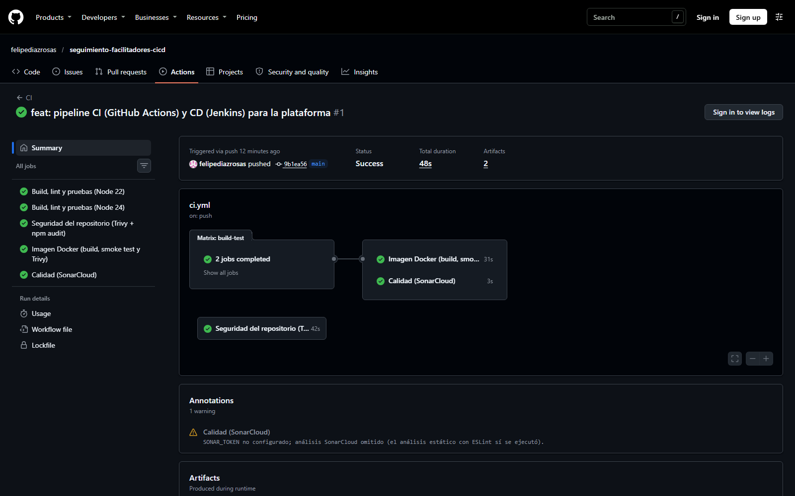 | **01** · GitHub Actions: ejecución verde de `ci.yml` (push a `main`) |
| 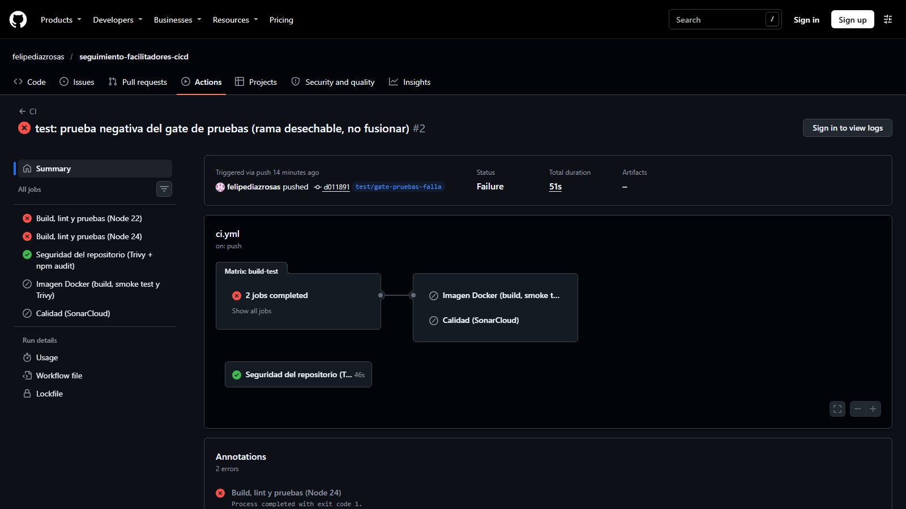 | **02** · GitHub Actions: prueba negativa; `build-test` rojo, `docker` y `sonar` omitidos |
| 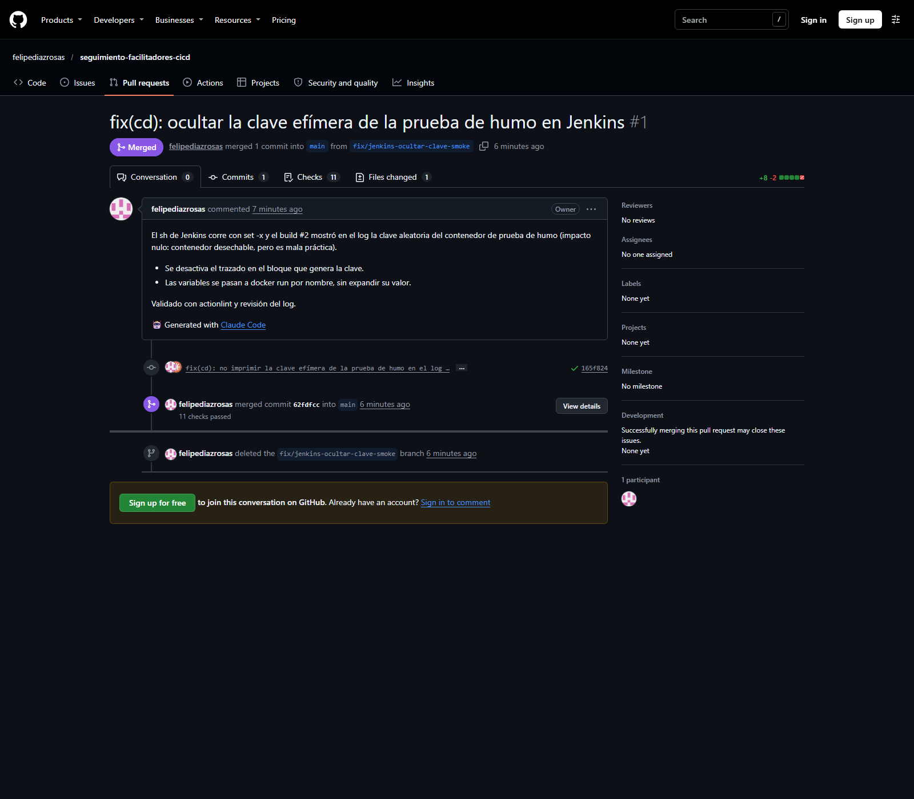 | **03** · Pull request #1 fusionado con 11 checks aprobados |
| 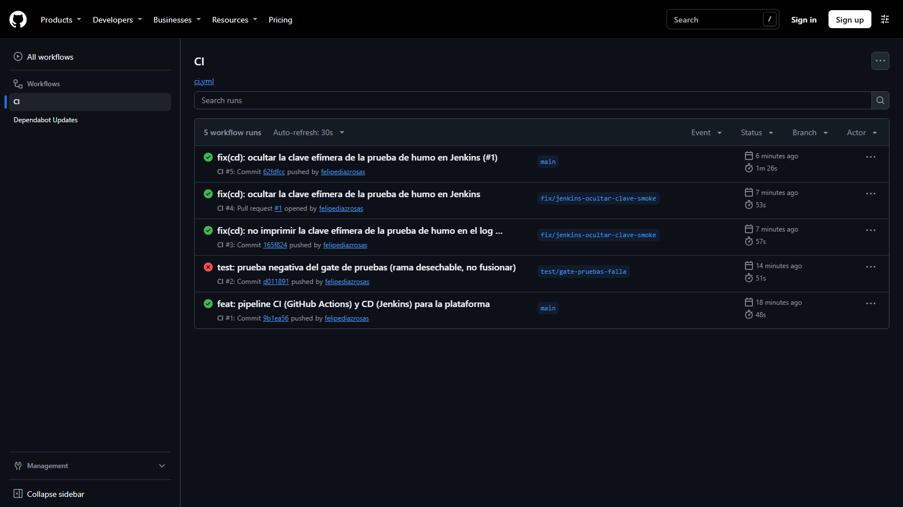 | **04** · Historial de ejecuciones del workflow CI |
| 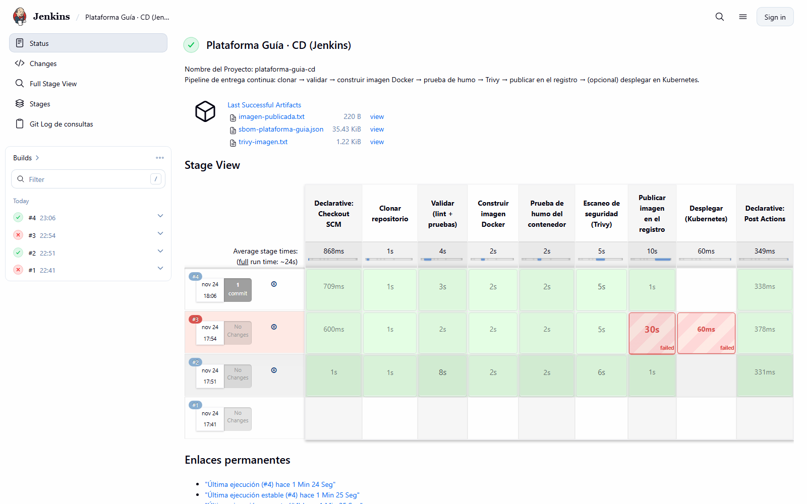 | **05** · Jenkins: *stage view* de los builds #1–#4 y artefactos |
| 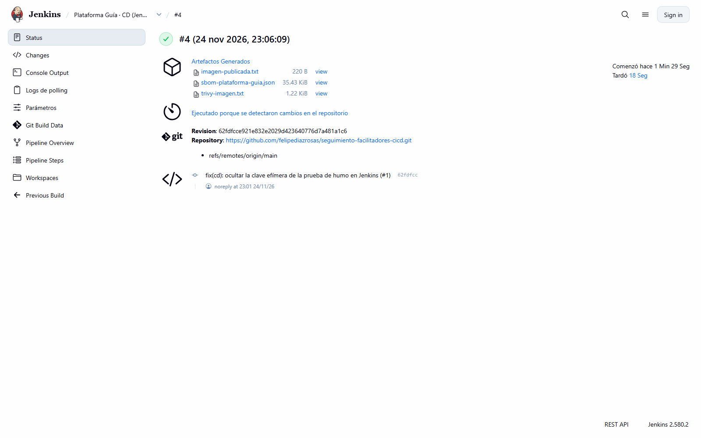 | **06** · Jenkins: build #4 «ejecutado porque se detectaron cambios en el repositorio» |
| 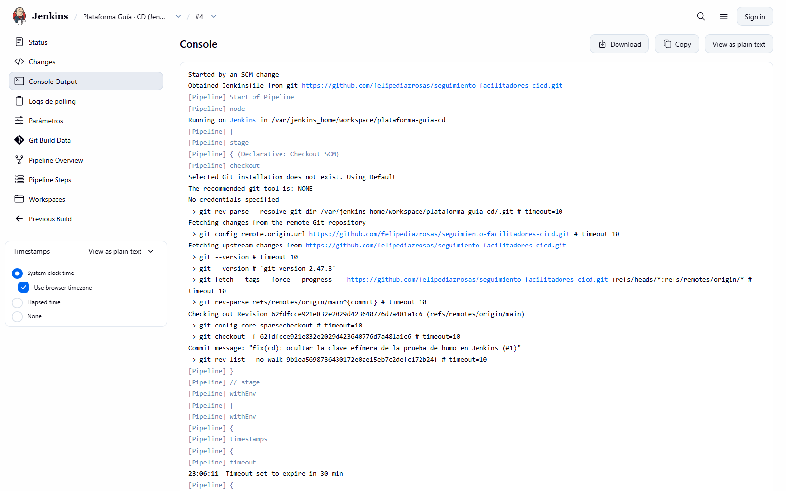 | **07** · Jenkins: consola del build #4 (clonado desde GitHub) |
| 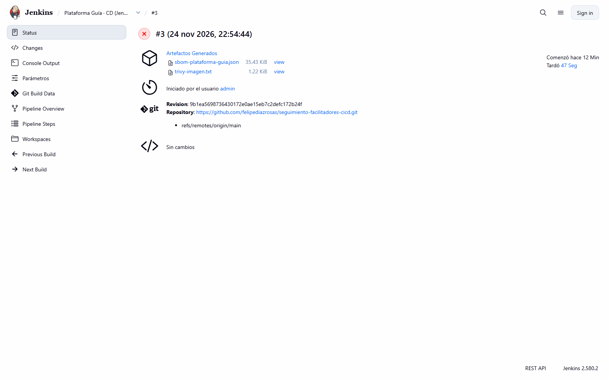 | **08** · Jenkins: build #3 fallido (prueba negativa contra un registro inexistente). El mensaje «no se hace rollback» consta en `reportes/13-jenkins-build-3.txt`, y el stage en el que falló, en la captura 05 |
| 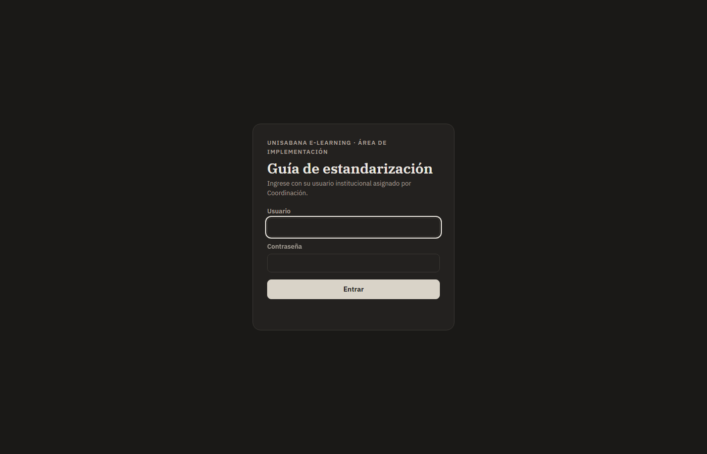 | **09** · Aplicación ejecutándose desde la imagen publicada por Jenkins |
| 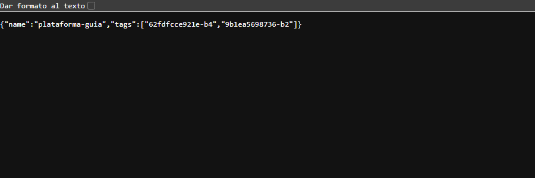 | **10** · Registro de imágenes con las dos versiones publicadas |
| 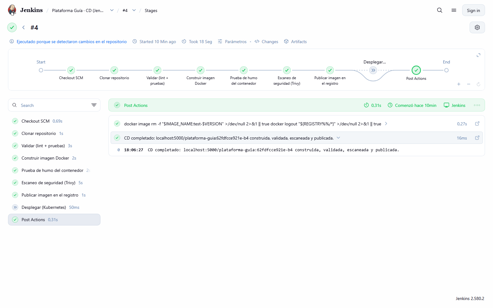 | **11** · Jenkins: grafo de stages del build #4 (todos en verde; «Desplegar» omitido por `DEPLOY_TARGET=none`) |

## 12. Problemas encontrados

| # | Problema |
|---|---|
| 1 | ESLint reportó 19 errores en el código original: falsos positivos del diseño con scripts globales |
| 2 | Pruebas con arreglos de otro *realm* de `vm`, y carpeta de cobertura inexistente |
| 3 | El push del workflow fue rechazado: el token no tenía el scope `workflow` |
| 4 | Jenkins no tenía acceso al socket de Docker (`root:root 660`) |
| 5 | El build #1 falló porque pollSCM consultó GitHub antes del primer push |
| 6 | **El log del build #2 mostró la clave efímera de la prueba de humo** (trazado `set -x` de Jenkins) |
| 7 | El SARIF de Trivy incluyó alertas LOW pese al filtro de severidad |
| 8 | Hallazgos de fondo: SheetJS vulnerable no detectable por escáneres; 62 frente a 63 controles; la aplicación no admite varias réplicas |

## 13. Soluciones aplicadas

| # | Solución |
|---|---|
| 1 | Configuración de ESLint ajustada al diseño (globales compartidas, `allowEmptyCatch`, excepción justificada), **sin cambiar el código** |
| 2 | `Array.from` y un script `pretest:coverage` multiplataforma |
| 3 | El propietario amplió el permiso con `gh auth refresh -s workflow` |
| 4 | `group_add: ["0"]` en lugar de ejecutar Jenkins como root |
| 5 | Documentado; el build #2 se lanzó con el repositorio ya poblado |
| 6 | `set +x` y variables pasadas por nombre, entregado por **pull request** (PR #1). Los logs exportados se redactaron, y el build #4 confirmó que la clave ya no se imprime |
| 7 | Las 3 alertas LOW se analizaron: DS-0026 se corrigió y KSV-0020/0021 se aceptaron con justificación |
| 8 | Riesgos documentados con mitigación. Despliegue k8s con 1 réplica y `Recreate`; la discrepancia se informa a los autores |

## 14. Conclusiones

1. Se cumplieron los requisitos obligatorios de la guía. El CI se ejecuta solo en cada push y pull request, con checkout, instalación de dependencias, pruebas y análisis estático. El Jenkinsfile define y **ejecuta** los stages de clonado, construcción de la imagen y publicación en un registro. La guía solo exigía definirlos.
2. El valor de un pipeline está en que **bloquee** lo defectuoso, no en el número de herramientas. Por eso cada gate se demostró en rojo y en verde.
3. La continuidad con la Actividad 2 se mantuvo: GitHub con PR, CI en Actions, seguridad de dependencias y secretos, Docker, rollback y autorización en el servidor, ahora verificada con pruebas. El único cambio, el CD en Jenkins, responde a la guía y se justificó.
4. La implementación detectó problemas reales que la revisión manual había pasado por alto: una clave impresa en un log, una librería vulnerable que ningún escáner ve y una discrepancia entre la documentación y el código. Es el propósito de DevSecOps: dar retroalimentación temprana y trazable (Kim et al., 2022).
5. **Pendientes:** SonarCloud y Docker Hub requieren credenciales del propietario. El despliegue en Kubernetes y el monitoreo corresponden a las fases que anuncia la guía, y los manifiestos y el stage de despliegue ya están preparados.

## 15. Referencias

- GitHub. (s. f.). *GitHub Actions documentation*. https://docs.github.com/actions
- Jenkins. (s. f.). *Pipeline syntax*. https://www.jenkins.io/doc/book/pipeline/syntax/
- Jenkins. (s. f.). *Configuration as Code*. https://www.jenkins.io/projects/jcasc/
- Kim, G., Humble, J., Debois, P., Willis, J. y Forsgren, N. (2022). *Manual de DevOps: Transformación exitosa de equipos, herramientas e infraestructura* (T. Demmig, Trad.; 2.ª ed.). dpunkt.
- Lwakatare, L. E., Kuvaja, P., Oivo, M., Jedlitschka, A., Nguyen Duc, A., Felderer, M., Abrahamsson, P., Amasaki, S. y Mikkonen, T. (2016). Relationship of DevOps to Agile, Lean and Continuous Deployment: A multivocal literature review study. En *Product-Focused Software Process Improvement* (pp. 399–415). Springer. https://doi.org/10.1007/978-3-319-49094-6_27
- Aqua Security. (s. f.). *Trivy documentation*. https://trivy.dev/latest/docs/
- OWASP Foundation. (2021). *OWASP Top 10:2021*. https://owasp.org/Top10/
- Kubernetes. (s. f.). *Pod Security Standards*. https://kubernetes.io/docs/concepts/security/pod-security-standards/
- Turnbull, J. (2014). *The Docker Book: Containerization is the new virtualization*. Turnbull Press.
