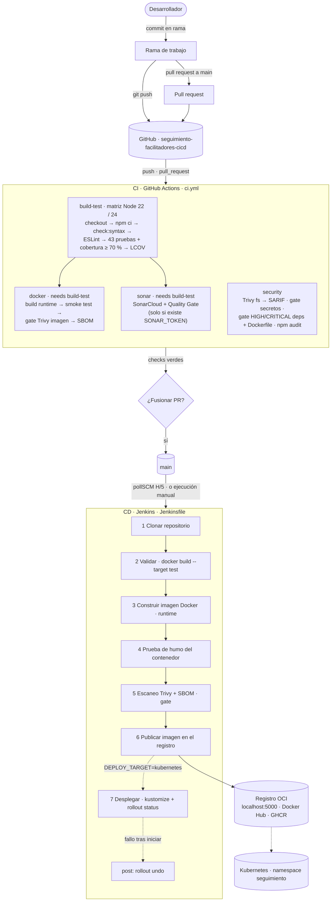

# Pipeline DevOps/DevSecOps implementado

Este documento describe, etapa por etapa, los dos pipelines de la Actividad 3, cómo se activan, qué bloquea cada uno y por qué se diseñaron así.
Los archivos son la fuente de verdad: [`.github/workflows/ci.yml`](../.github/workflows/ci.yml) y [`Jenkinsfile`](../Jenkinsfile).

## 1. Visión general

**División de responsabilidades.** GitHub Actions **valida** cada cambio (CI). Jenkins **entrega** el artefacto (CD): construye, verifica y publica la imagen y, si se pide, la despliega.
Es la combinación que exige la guía, y además separa los permisos: el CI no tiene credenciales de ningún registro, y el CD solo trabaja sobre la rama `main` ya validada.

## 2. CI — GitHub Actions (`.github/workflows/ci.yml`)

### 2.1 Disparadores y configuración global

| Elemento | Valor | Motivo |
|---|---|---|
| `on.push` | Todas las ramas (`'**'`) y tags `v*` | La guía exige ejecución «ante cada push» |
| `on.pull_request` | Hacia `main` | La guía exige ejecución «ante cada pull request»; valida el resultado de la fusión |
| `workflow_dispatch` | Habilitado | Re-ejecución manual sin commits |
| `permissions` | `{}` global; mínimos por job | Mínimo privilegio: el token de cada job solo puede lo que necesita |
| `concurrency` | Por workflow y ref, con `cancel-in-progress` | Evita gastar minutos en ejecuciones obsoletas de la misma rama |
| Acciones | Todas fijadas por **SHA** con un comentario de versión | Cadena de suministro: un tag puede moverse o desaparecer (le pasó a la referencia) |
| Trivy | `version: v0.76.2` | Resultados reproducibles |

> Al abrir un PR desde una rama del mismo repositorio se ejecutan dos corridas (`push` y `pull_request`). Es intencional: la primera valida la rama y la segunda el *merge commit*. Ambas aparecen en la evidencia (PR #1).

### 2.2 Jobs y pasos

| # | Job | Pasos | Gate (bloquea si…) | Salida |
|---|---|---|---|---|
| 1 | **build-test** (Node 22 y 24) | 1. Checkout · 2. setup-node con caché npm · 3. **Instalación de dependencias** `npm ci` · 4. **Compilación**: `npm run check:syntax` (`node --check` de los 6 módulos) · 5. **Análisis estático**: `npm run lint` (ESLint) · 6. **Pruebas**: `npm run test:coverage` | Error de sintaxis, error de ESLint, prueba fallida o cobertura de líneas < 70 % | Artefacto `coverage` (LCOV) |
| 2 | **security** | Trivy fs (vuln + secret + misconfig) → SARIF → *Security › Code scanning* · gate de secretos · gate de dependencias y Dockerfile HIGH/CRITICAL con corrección disponible · `npm audit --audit-level=high` | Cualquier secreto; vulnerabilidad o misconfiguración HIGH/CRITICAL corregible; npm audit ≥ high | SARIF (categoría `trivy-fs`) |
| 3 | **docker** (`needs: build-test`) | Build de la etapa `runtime` con la revisión como label · **prueba de humo**: contenedor de solo lectura, sin capacidades; verifica `/api/health`, `/` = 200, `/server/server.js` = 403 y uid ≠ 0 · gate Trivy de la imagen · SBOM CycloneDX | Smoke fallido o HIGH/CRITICAL corregible en la imagen | Artefacto `sbom` |
| 4 | **sonar** (`needs: build-test`) | Si existe `SONAR_TOKEN`: checkout completo, descarga del LCOV, SonarCloud con `sonar.qualitygate.wait=true`. Si no: anotación de advertencia | Quality Gate «Failed» (cuando está activo) | Análisis en SonarCloud |

### 2.3 Por qué estas etapas

- **Matriz Node 22/24.** El servidor declara compatibilidad con las LTS vigentes (`engines: >=22`). La imagen usa Node 24, y probar ambas detecta incompatibilidades antes de cambiar de versión.
- **«Compilar» en JavaScript sin build.** No hay transpilación. El equivalente verificable es comprobar la sintaxis de todos los módulos, incluidos los del navegador que las pruebas no ejecutan.
- **Pruebas de integración HTTP en proceso** (skill 04). Levantan el servidor real en un puerto efímero con datos temporales y verifican el contrato de `db/contrato-api.md`: autenticación, bloqueo por intentos, permisos por rol, cifrado en disco y archivos protegidos. Las reglas de negocio del navegador (`fase()`, pesos de carga, utilidades de Excel) se prueban extrayendo las funciones del archivo real, sin modificarlo.
- **Seguridad en paralelo** con las pruebas (*shift-left*). No depende del código compilado y acorta el tiempo total.
- **La imagen solo se construye si las pruebas pasan** (`needs`). Lo demuestra la ejecución roja: `docker` y `sonar` quedaron *skipped*.

## 3. CD — Jenkins (`Jenkinsfile`)

### 3.1 Diseño

- **Pipeline declarativo, versionado junto al código** (*pipeline as code*). Jenkins lo lee de la rama `main` del repositorio (job `plataforma-guia-cd`, definido por JCasC en [`jenkins/casc.yaml`](../jenkins/casc.yaml)).
- **Entorno agnóstico.** El agente solo necesita Docker. Node.js, ESLint y Trivy corren en contenedores con versión fijada, así que el mismo Jenkinsfile funciona en cualquier agente con Docker, sin plugins de lenguaje.
- **Parámetros**:

| Parámetro | Por defecto | Uso |
|---|---|---|
| `REGISTRY` | `localhost:5000` | Registro destino: el de laboratorio, `docker.io/<usuario>` o `ghcr.io/<owner>` |
| `REGISTRY_CREDENTIALS_ID` | vacío | ID de la credencial Jenkins (usuario/token). Vacío = registro sin autenticación |
| `PUSH_LATEST` | `false` | Publicar también `latest` (nunca se usa para desplegar) |
| `DEPLOY_TARGET` | `none` | `kubernetes` activa el stage de despliegue |

- **Opciones**: `timestamps()`, `timeout(30 min)`, `disableConcurrentBuilds()` (dos despliegues simultáneos nunca), `buildDiscarder(20)`.

### 3.2 Stages

| # | Stage | Requisito de la guía | Qué hace | Por qué |
|---|---|---|---|---|
| 1 | **Clonar repositorio** | **Sí** («Clonar el repositorio») | `checkout scm`; calcula `VERSION = <sha12>-b<build>` e `IMAGE_REF` | Trazabilidad: cada imagen identifica su commit y su build |
| 2 | Validar (lint + pruebas) | Añadido | `docker build --target test` (npm ci + ESLint + 43 pruebas dentro del contenedor) | No se entrega lo que no pasa las pruebas; el CD no depende solo del CI |
| 3 | **Construir imagen Docker** | **Sí** («Construir una imagen Docker») | `docker build --target runtime` con `APP_VERSION` y `VCS_REF` como labels OCI | Imagen mínima, no root, sin npm |
| 4 | Prueba de humo del contenedor | Añadido | Arranca la imagen endurecida con claves efímeras ocultas y verifica `/api/health` y uid ≠ 0 | Se publica solo una imagen que arranca de verdad |
| 5 | Escaneo de seguridad (Trivy) | Añadido | Reporte HIGH/CRITICAL y SBOM archivados; **gate** `--ignore-unfixed --exit-code 1` | Nada vulnerable llega al registro |
| 6 | **Publicar imagen en el registro** | **Sí** («Publicar la imagen en un registro») | Login opcional con `--password-stdin` → `docker push` → registra el digest en `imagen-publicada.txt` | Artefacto inmutable y verificable (digest) |
| 7 | Desplegar (Kubernetes) | Contexto (fase posterior) | Solo con `DEPLOY_TARGET=kubernetes`: overlay de kustomize con la imagen exacta → `apply -k` → `rollout status` → health dentro del pod | Prepara la fase k8s que anuncia la guía sin desplegar nada por defecto |
| post | `failure` / `always` | — | `rollout undo` **solo si** `DEPLOY_STARTED == 'true'`; siempre: limpia la imagen de prueba y hace `docker logout` | Corrige el rollback incondicional de la referencia |

### 3.3 Credenciales (nunca en el repositorio)

| ID en Jenkins | Tipo | Cuándo se necesita |
|---|---|---|
| `registry-creds` (u otro, por parámetro) | Usuario + token | Publicar en Docker Hub o GHCR |
| `kubeconfig` | Secret file (kubeconfig limitado al namespace) | `DEPLOY_TARGET=kubernetes` |

## 4. Matriz de etapas, herramientas y gates (skill 01)

| Etapa | Herramienta | Entrada | Salida / artefacto | Criterio de bloqueo | Dónde |
|---|---|---|---|---|---|
| Control de versiones | Git + GitHub | Commits, PR | Historial, checks | PR con checks rojos (protección de rama recomendada) | GitHub |
| Instalación | npm ci | `package-lock.json` | `node_modules` | Lockfile inconsistente | CI, Jenkins |
| Compilación | `node --check` | Fuentes JS | — | Error de sintaxis | CI |
| Análisis estático | ESLint 10 | Fuentes JS | Reporte | Cualquier error | CI, Jenkins |
| Pruebas | `node:test` | Fuentes + pruebas | LCOV | Prueba fallida o cobertura < 70 % | CI, Jenkins |
| Calidad | SonarCloud | Fuentes + LCOV | Análisis | Quality Gate «Failed» | CI (con token) |
| Secretos | Trivy secret | Repositorio | SARIF | ≥ 1 secreto | CI |
| SCA | Trivy vuln + npm audit | Lockfile | SARIF | HIGH/CRITICAL corregible | CI |
| IaC / Dockerfile | Trivy misconfig, hadolint | Dockerfile, k8s | SARIF | HIGH/CRITICAL | CI |
| Imagen | Docker (BuildKit) | Dockerfile | Imagen OCI | Build fallido | CI, Jenkins |
| Smoke test | Docker + curl/wget | Imagen | — | Health ≠ ok o uid 0 | CI, Jenkins |
| Escaneo de la imagen | Trivy image | Imagen | Reporte + SBOM | HIGH/CRITICAL corregible | CI, Jenkins |
| Publicación | docker push | Imagen | Tag + digest | Push fallido | Jenkins |
| Despliegue | kubectl + kustomize | Overlay | Deployment | `rollout status` sin converger | Jenkins (opcional) |
| Reversión | kubectl rollout undo | — | Revisión anterior | — | Jenkins (`post`) |
